# 🛡️ Aegis-W1™ (`v1.0.0-hardened`): Aerospace-Grade Autonomous AI Defense & Anti-Escape Fortress
### حصن وقبة الدفاع الإدراكي لسلامة الذكاء الاصطناعي ومنع خروج الوكلاء

<div align="center">


[](https://github.com/mohammedouassimbentebba-collab/Aegis-W1/releases/tag/v1.0.0-hardened)
[](https://github.com/mohammedouassimbentebba-collab/Aegis-W1/actions)
[-00c853?style=for-the-badge&logo=checkmarx)](tests/)
[](src/server.js)
[](src/radar_machine_code/linux_kernel/)
[](src/audit/siem_exporter.js)

</div>

---

## 🔒 What Is New in `v1.0.0-hardened`

`v1.0.0-hardened` transitions **Aegis-W1™** from research prototype into an enterprise **Fail-Closed Zero-Trust** runtime validated across 4 progressive security engineering batches:

- **Strict Fail-Closed Cryptography & Identity (`SEC-01..SEC-13`):** Eliminates all hardcoded fallback secrets and unsigned tokens. Capability tokens require HMAC-SHA256 verification with `timingSafeEqual` and single-use nonces with anti-DoS bounded caches.
- **Hardened Production Server Entrypoint ([`src/server.js`](src/server.js)):** Replaces stub exports with a dual-daemon launcher (`AiTestbedGateway` + `LiveAIFirewallProxy`) enforcing **256-bit high-entropy secrets** (rejects missing, short, repeating, or sequential keys), Slowloris HTTP socket timeouts (`headersTimeout`, `requestTimeout`, `keepAliveTimeout`), and graceful `SIGTERM`/`SIGINT` shutdown.
- **Enterprise Probes (`/healthz` & `/readyz`):** Kubernetes-ready Liveness (`GET /healthz`) and Readiness (`GET /readyz`) endpoints tracking asynchronous `ContainerIsolationEngine` initialization without leaking secrets or host filesystem paths.
- **Layer 1.5 & 4.5 Pre-Execution Vulnerability & Zero-Day Pipeline:** Wires [`NucleiTemplateEngine`](src/vulnerability_scanner/nuclei_template_engine.js) and [`ZeroDayDetector`](src/vulnerability_scanner/zero_day_detector.js) directly into [`FortressCommander`](src/orchestrator/fortress_commander.js), fortified with `MAX_EXTRACT_DEPTH = 32` and `WeakSet` circular-reference DoS protection.
- **100% Ensemble Latent Space Sonar (`HARDEN-01`):** [`DeepSubmarineSonar`](src/defense_grid/deep_submarine_sonar.js) evaluates 4 cryptographically rotated orthonormal Gram-Schmidt projection bases (including an orthogonal complement pair), eliminating single-basis temporal blind spots.
- **Bounded SOC/SIEM Audit Exporter ([`src/audit/siem_exporter.js`](src/audit/siem_exporter.js)):** Emits SHA-256 fingerprinted audit events from a `10,000`-entry ring buffer to append-only **NDJSON** (`W1_AUDIT_LOG_PATH`) and asynchronous **HTTPS Webhooks** (`W1_SIEM_WEBHOOK_URL`) capped at `maxInFlightWebhooks = 64` so external sink outages never block defense decisions.
- **Non-Root Systemd & Hardened Linux Ring-0 Driver (`SYS-05`, `OPS-16`):** [`w1-defense.service`](src/linux_os/w1-defense.service) drops `CAP_SYS_RAWIO` and runs as unprivileged `User=w1defense` with `PrivateDevices=true`; [`w1_vhf_stealth_radar.c`](src/radar_machine_code/linux_kernel/w1_vhf_stealth_radar.c) enforces `capable(CAP_SYS_ADMIN)`, PRF bounds, zeroed stack/heap copies before spinlock release, and compiles cleanly under Linux 6.x `Kbuild -Werror`.

---

## ⚡ Live Interception Matrix & Real-Time Radar HUD

<div align="center">




> 🎮 **Interactive 60 FPS Simulation:** Open [`assets/interactive_defense_matrix.html`](assets/interactive_defense_matrix.html) in any browser to inspect agent escape interception, SEAD swarm assaults, and point-defense layers in real time.

</div>

---

## 🌐 Architectural Overview: Dual-Plane Defense Doctrine

```
┌─────────────────────────────────────────────────────────────────────────────────────────────┐
│                   PRODUCTION ENTRYPOINT (src/server.js) & HEALTH PROBES                     │
│     • GET /healthz (Liveness) • GET /readyz (Readiness) • 256-bit Secret Entropy Guard      │
└───────────────────────────────────────────────┬─────────────────────────────────────────────┘
                                                │
┌───────────────────────────────────────────────▼─────────────────────────────────────────────┐
│                   SUPERVISORY & MATHEMATICAL PROVING PLANE (Fail-Closed)                    │
│                                                                                             │
│  Layer -1..1: EW / Radar ISR (Cognitive Injection & Jamming)                                │
│  Layer 1.5  : NucleiTemplateEngine + ZeroDayDetector (Prompt Scan + SIEM Audit Event)       │
│  Layer 2    : DeepSubmarineSonar (4-Basis Orthogonal SVD Ensemble Projections)              │
│  Layer 3    : Byzantine Counter-Intelligence Council (BFT Quorum)                           │
│  Layer 4    : OSFirewallShield (Allowlist Containment, Symlink & Anti-Worm Scrubbing)       │
│  Layer 4.5  : ZeroDayDetector (Depth/Cycle DoS Guard) + Nuclei Parameter Scan               │
│  Layer 5    : DeterministicKernel + StaticLinter + CapabilityTokenManager -> Crypto DAG     │
└───────────────────────────────────────────────┬─────────────────────────────────────────────┘
                                                │ (SIEM NDJSON + HTTPS Webhook / Syscalls / IOCTL)
┌───────────────────────────────────────────────▼─────────────────────────────────────────────┐
│                                 NATIVE EXECUTION & KERNEL PLANE                             │
├──────────────────────────────────────┬──────────────────────────────────────────────────────┤
│               LINUX OS               │                     ANDROID OS                       │
├──────────────────────────────────────┼──────────────────────────────────────────────────────┤
│ • Ring-0 Driver: w1_vhf_stealth_radar│ • ARM NEON SIMD: w1_radar_neon.cpp                   │
│ • Non-Root Daemon: w1-defense.service│ • JNI & Enclave: W1AndroidSecurityEnclave.kt         │
│ • cgroups v2, unshare, Landlock, BPF │ • Hardware Keystore / StrongBox Isolation            │
└──────────────────────────────────────┴──────────────────────────────────────────────────────┘
```

---

## 🚀 Quick Start & Production Deployment (`v1.0.0-hardened`)

### 1. Environment Configuration (Fail-Closed)
Copy [`.env.example`](.env.example) to `.env` (never commit `.env`) and generate strong 256-bit secrets:

```bash
cp .env.example .env

# Generate cryptographically random 256-bit secrets (64 hex chars each)
openssl rand -hex 32   # -> W1_CAPABILITY_HMAC_KEY
openssl rand -hex 32   # -> W1_SUPERVISOR_SECRET
openssl rand -hex 32   # -> W1_IFF_SECRET
```

Optional enterprise observability variables in `.env`:
```env
W1_AUDIT_LOG_PATH=/var/log/w1_defense/audit.ndjson
W1_SIEM_WEBHOOK_URL=https://siem.example.internal/v1/w1-events
W1_SIEM_TIMEOUT_MS=2000
W1_HEADERS_TIMEOUT_MS=10000
W1_REQUEST_TIMEOUT_MS=30000
```

### 2. Run Verification Suite & Start Production Server
```bash
# Run full 206-test security, red-team, kernel ABI & probe suite
npm test

# Start hardened Gateway (port 8081) & Live Firewall Proxy (port 8080)
# Fails closed with non-zero exit if mandatory secrets are absent or weak
npm start
```

### 3. Verify Liveness & Readiness Probes
```bash
# Liveness probe (200 OK while process is responsive)
curl -fsS http://127.0.0.1:8080/healthz

# Readiness probe (200 OK once ContainerIsolationEngine & both daemons are ready; 503 otherwise)
curl -fsS http://127.0.0.1:8080/readyz
```

### 4. Linux Ring-0 Kernel Driver & Non-Root `systemd` Deployment
```bash
# Compile Linux kernel module cleanly with -Werror
cd src/radar_machine_code/linux_kernel
make KCFLAGS="-Werror"
modinfo w1_vhf_radar.ko

# Provision dedicated unprivileged service account & hardened unit
sudo useradd --system --no-create-home --shell /usr/sbin/nologin w1defense
sudo install -d -m 0750 -o root -g w1defense /etc/w1_defense
sudo cp .env /etc/w1_defense/w1.env && sudo chmod 0640 /etc/w1_defense/w1.env
sudo cp src/linux_os/w1-defense.service /etc/systemd/system/
sudo systemd-analyze verify /etc/systemd/system/w1-defense.service
sudo systemctl daemon-reload && sudo systemctl enable --now w1-defense.service
```

---

## 📊 Verification & CI Pipeline

- **Automated GitHub Actions CI ([`.github/workflows/ci.yml`](.github/workflows/ci.yml)):** Runs on every `push`, tag (`v*`), and `pull_request` on `ubuntu-latest`:
  1. Executes all **206 unit, red-team & regression tests across 61 suites** (`npm test`).
  2. Installs Linux kernel headers and builds `w1_vhf_radar.ko` via `Kbuild` with `KCFLAGS="-Werror"`.
  3. Validates `src/linux_os/w1-defense.service` using `systemd-analyze verify` with non-root account checks.

```text
ℹ tests 206 | suites 61 | pass 206 | fail 0 | skipped 0
```

---

## 📜 License & Compliance

Designed and verified under **DO-178C Level A** safety-critical defense-in-depth engineering principles.  
Licensed under the [Apache License, Version 2.0](LICENSE).
